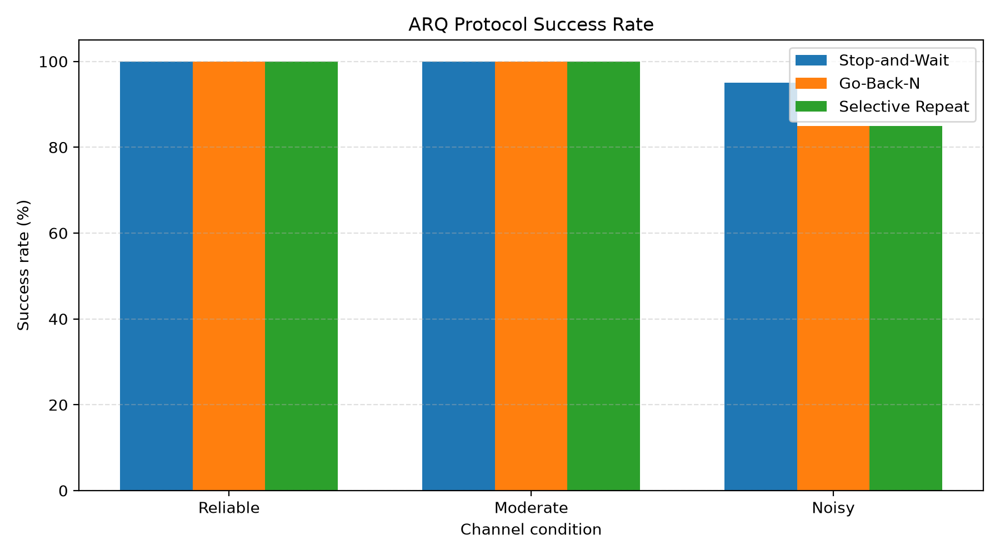
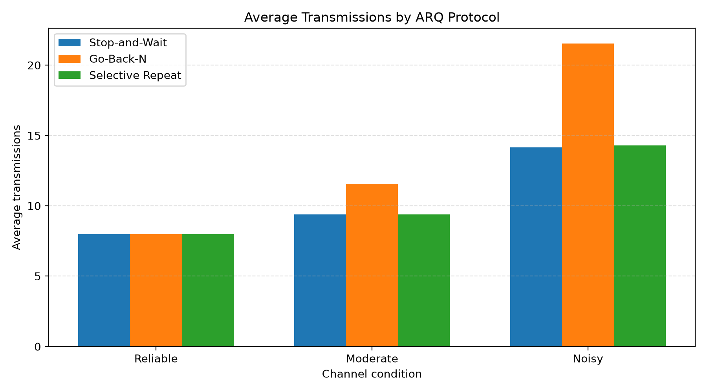
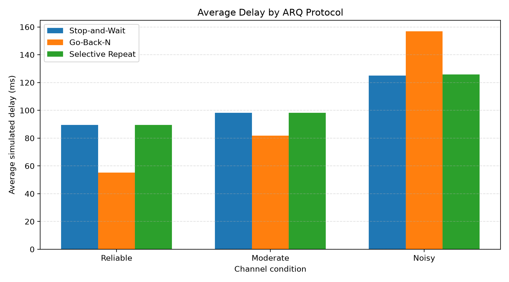

# Network Transmission Reliability and Error Recovery Simulator

## 1. Project Overview

The Network Transmission Reliability and Error Recovery Simulator is a Python-based Computer Networks project that demonstrates error detection, error correction, unreliable communication channels, and reliable data transmission protocols.

The simulator allows users to study how packet loss, bit errors, acknowledgement (ACK) loss, and transmission delay affect data delivery. It implements CRC and Hamming Code for error control and compares Stop-and-Wait ARQ, Go-Back-N ARQ, and Selective Repeat ARQ.

The project also runs repeatable experiments and generates CSV reports and graphs to compare protocol performance under different simulated channel conditions.

## 2. Objectives

- Implement CRC for detecting transmission errors.
- Implement Hamming Code for single-bit error correction.
- Simulate packet loss, bit corruption, ACK loss, and transmission delay.
- Implement and compare three ARQ error-control protocols.
- Measure transmission attempts, retransmissions, delivery success, and simulated delay.
- Generate CSV files and graphs for performance analysis.

## 3. Features

### Error Detection and Correction
- CRC encoding and error detection.
- Hamming Code encoding and single-bit error correction.

### Unreliable Channel Simulation
- Configurable bit error probability.
- Configurable packet loss probability.
- Configurable ACK loss probability.
- Configurable minimum and maximum transmission delay.
- Random seed support for reproducible experiments.

### Reliable Transmission Protocols
- Stop-and-Wait ARQ.
- Go-Back-N ARQ.
- Selective Repeat ARQ.

### Performance Evaluation
- Automated protocol comparison.
- Three simulated channel conditions: Reliable, Moderate, and Noisy.
- 20 random seeds per condition.
- 180 protocol experiments in total.
- CSV summaries and PNG graphs.

## 4. Technologies Used

- Python 3
- Python standard library: `unittest`, `csv`, `random`, `dataclasses`, and `pathlib`
- Matplotlib for plotting
- Git and GitHub for version control

## 5. Project Structure

```text
CN_Reliability_Simulator/
├── src/
│   ├── main.py
│   ├── crc.py
│   ├── hamming.py
│   ├── channel.py
│   ├── protocols.py
│   ├── metrics.py
│   ├── evaluate.py
│   └── plot_results.py
├── tests/
│   ├── test_error_control.py
│   ├── test_channel.py
│   └── test_protocols.py
├── results/
│   ├── protocol_comparison_raw.csv
│   ├── protocol_comparison_summary.csv
│   ├── success_rate.png
│   ├── average_transmissions.png
│   └── average_delay.png
├── docs/
├── requirements.txt
└── README.md
```

## 6. Setup Instructions

Python 3 and pip are required. The commands below use the Fish shell on macOS.

Clone the repository and enter the project directory:

```bash
git clone https://github.com/Apple-by/CN-Reliability-Simulator.git
cd CN-Reliability-Simulator
```

Create and activate a virtual environment:

```fish
python3 -m venv .venv
source .venv/bin/activate.fish
```

Install Matplotlib:

```bash
python3 -m pip install matplotlib
```

## 7. Running the Simulator

Start the interactive command-line application:

```bash
python3 -m src.main
```

The menu provides the following options:

1. CRC Error Detection
2. Hamming Code Error Correction
3. Stop-and-Wait ARQ
4. Go-Back-N ARQ
5. Selective Repeat ARQ
6. Compare All ARQ Protocols
0. Exit

Enter binary data packets when prompted. For example:

```text
1011,1100,0101
```

For the ARQ protocols, configure the channel probabilities, delay range, random seed, retry limit, and sliding window size where applicable.

## 8. Running the Tests

Run all automated tests:

```bash
python3 -m unittest discover -s tests -v
```

The tests cover error-control algorithms, channel behavior, invalid inputs, and ARQ protocol behavior.

## 9. Running Performance Experiments

Run the experiment suite:

```bash
python3 -m src.evaluate
```

This evaluates three protocols under three channel conditions using 20 seeds per condition, for a total of 180 protocol runs.

The generated files are:

- `results/protocol_comparison_raw.csv` — individual experiment results.
- `results/protocol_comparison_summary.csv` — average metrics grouped by scenario and protocol.

Generate the graphs:

```bash
python3 -m src.plot_results
```

The graphs are saved as:

- `results/success_rate.png`
- `results/average_transmissions.png`
- `results/average_delay.png`

## 10. Evaluation Metrics

- **Success rate:** Percentage of experimental runs in which all input packets were successfully delivered according to the protocol's completion condition.
- **Transmissions:** Total number of data-frame transmission attempts.
- **Retransmissions:** Transmission attempts beyond the original number of input packets.
- **Packet loss:** Number of data packets dropped by the simulated channel.
- **Packet corruption:** Number of transmitted packets in which at least one bit was flipped.
- **ACK loss:** Number of acknowledgements dropped by the simulated channel.
- **Simulated delay:** Sum of the simulated delays recorded for packet and ACK transmission attempts.

## 11. Experimental Results

The initial experiment run produced the following summary:

| Channel | Protocol | Success Rate | Average Transmissions | Average Delay |
|---|---|---:|---:|---:|
| Reliable | Stop-and-Wait | 100% | 8.00 | 89.40 ms |
| Reliable | Go-Back-N | 100% | 8.00 | 55.15 ms |
| Reliable | Selective Repeat | 100% | 8.00 | 89.40 ms |
| Moderate | Stop-and-Wait | 100% | 9.40 | 98.20 ms |
| Moderate | Go-Back-N | 100% | 11.55 | 81.70 ms |
| Moderate | Selective Repeat | 100% | 9.40 | 98.20 ms |
| Noisy | Stop-and-Wait | 95% | 14.15 | 125.05 ms |
| Noisy | Go-Back-N | 85% | 21.55 | 156.95 ms |
| Noisy | Selective Repeat | 85% | 14.30 | 125.90 ms |

These values are results from the recorded experiment configuration, not universal performance guarantees. Results may change if the channel settings, packet data, seeds, retry limits, or window size change.

### Generated Graphs

**Success Rate**



**Average Transmissions**



**Average Simulated Delay**



## 12. Limitations

- This is a local simulation; it does not transmit data over a physical or live network.
- Channel errors, packet loss, ACK loss, and delay are generated by the simulator.
- Experiments use a fixed set of binary packets and configured channel conditions.
- Results describe the implemented algorithms and experiment settings; they are not measurements of real network throughput or latency.
- The evaluation uses a finite set of random seeds, so results may vary with different experimental settings.

## 13. Conclusion

The project demonstrates error detection, error correction, and reliable data transmission concepts from the Computer Networks syllabus. By simulating an unreliable channel and comparing three ARQ protocols, it shows how channel conditions can affect transmission attempts, simulated delay, and delivery success.

Automated tests, CSV reports, and performance graphs make the implementation easier to verify, demonstrate, and analyze.

## 14. Repository

GitHub: https://github.com/Apple-by/CN-Reliability-Simulator